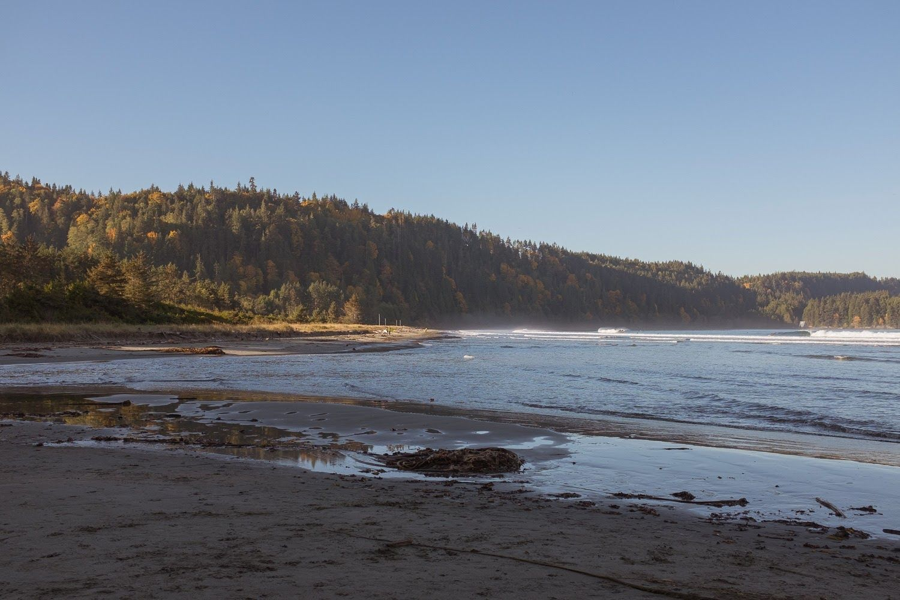

While I read this one quickly (typically a sign of enjoyment), I left with my continued distaste for murder-mysteries. I’m not quite sure if it’s the predictability or something else, but I’m probably not recommending this one to anyone soon. It wasn’t *bad*, but I just didn’t find that it stands out in any way.

However, the setting (assumedly the San Juan Islands) of the book reminded me of my fond appreciation for the region. The descriptions of the people, the buildings, the roads, etc matched my memory precisely.

