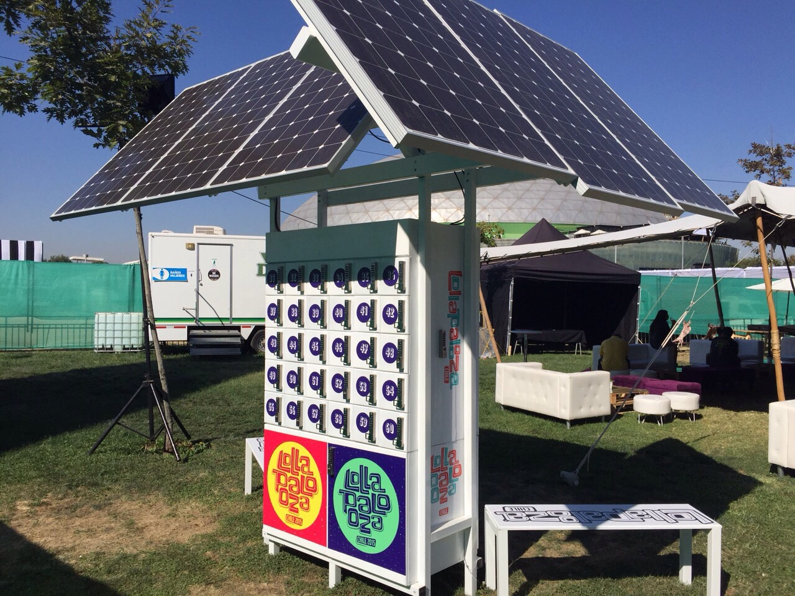
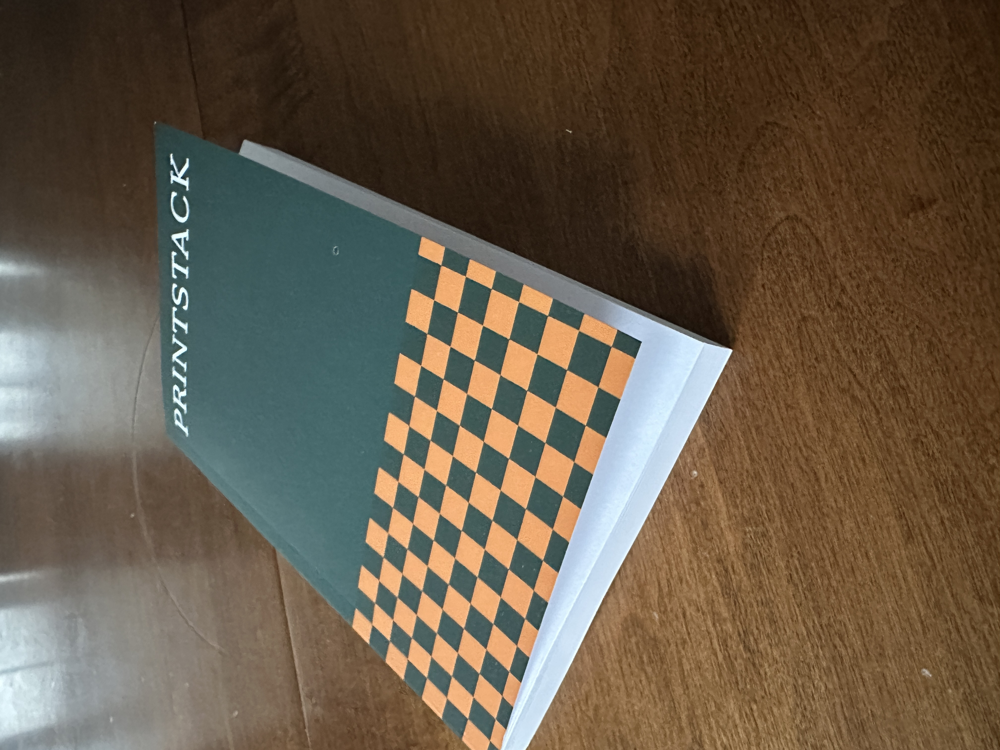

This not ideal, by the way. [Building fast](https://patrickcollison.com/fast) is the de facto ethos of the technology world (and for good reason). When building software, the only excuse for slowness is lethargy or a lack of urgency; both unacceptable. The feedback loop (whether it’s internal or external) is the specific thing I (and other operators) “work on”. Signal in competence or customer value needs to be delivered to the person who can do something about it and the better you can orchestrate this, the faster value is delivered and accrued.

Recently, however, in building a physical product in my spare time, my notion of *pace* has been shaken. PrintStack turns my online feeds (Substack, RSS, Research Papers, etc) into a print journal delivered to me regularly. It requires some software of course, but the end product is the physical journal where I can engage with the content without distraction; just me and the words on the paper. Getting the software up an running felt fast. The limiting factor was my free time  and, thanks to Cursor and a few other tools, a production app that could generate a print-ready pdf out of my feeds was up in no time. But then it came time to **print**. I do not, as I assume is the case for most people, have a printing press at home. So once the PDF looked good enough, it was about 2 longs weeks before I received my first test press. Once I had it in my hands could I *feel* the product and notice many things that I didn’t notice when looking at the PDF online; the font was too large, hyperlinked text was styled as if I could click on it, spacing between titles of articles and the content was funky, etc. It then occurred to me, “was every product iteration cycle going to have two-week waiting period within?”.

This is not my first time building a physical product. Years ago, my co-founder and I build a charging station powered by solar panels that could be dropped in anywhere (as long as there was sun). Although it was hardware (and yes, we had to wait for panels, batteries, inverters, etc to come from China), the feedback loop felt quicker because we were actually putting the hardware together, component by component. We could see the solar charging station come to life in front of our eyes. We continued building the frame and iterating on the design, reserving space for components that were still in transit. Because we had their exact specifications, we could build as though they were already present — invisible placeholders, but accounted for.

When it comes to PrintStack, I will not get to see the product (or even a copy of it) before it gets shipped to the customer. In software, rigorous testing (and an industry which works on this problem) is abound and the exact product the customer interacts with has had hundreds of hours of internal testing, beta-releases, etc. In hardware, prototypes are built and pushed to their limits until production begins to hum creating exact copies of the prototype that has passed the test. For PrintStack, however, the words on the page (which follows the file sent to the printer) is 1 of 1.

I never realized how much noise is on a webpage until I started removing it myself — stripping away layers to get to the words and images underneath. I'm not the first to have this insight ([Reader View](https://chromewebstore.google.com/detail/ecabifbgmdmgdllomnfinbmaellmclnh?utm_source=item-share-cb) got there long before me), but it took doing it myself to really appreciate it. I’ve spent the last few months doing exactly that. I’m sure there’s a faster way (piggybacking on Reader View libraries out there) to clean html content for print, but this is a rare opportunity I get to build slowly so I’m happy doing it the hard way.

